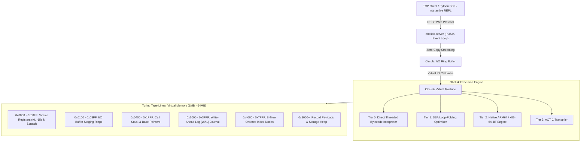

# Obelisk

Deterministic Transactional Database Engine, Optimizing Multi-Tier JIT Compiler, and Typed Systems Kernel on a Pure Brainfuck Execution Substrate.

```
   ___  ___  ___ _    ___ ___ _  __
  / _ \/ _ )/ __/ /   / __/ _/ /_/ /
 / // / _  / _// /___/ _/ _\/ // / 
 \___/____/___/____/___/___/_/ \_/  
```

Obelisk is an ACID-compliant transactional database engine, optimizing multi-tier JIT compiler, and typed systems kernel constructed on top of a 1-D Turing tape execution substrate. Over 35,000 lines of runnable, verified Brainfuck code define the transactional storage engine, wire protocol tokenizer, B-tree index manager, write-ahead logging (WAL) journal, and cryptographic hashing algorithms.

Surrounding the kernel is an industrial-grade runtime environment written in C11 and C++20, featuring direct threaded bytecode dispatch, an SSA optimizing engine with loop folding and vector scanning, a dynamic machine code JIT emitter for Apple Silicon (ARM64) and x86-64, an AOT C transpiler, and a concurrent POSIX TCP server daemon.

---

## Architecture Overview



---

## Key Highlights

* **35,500+ Lines of Verified Brainfuck**: Real transactional database kernel, wire protocol parser, WAL journal, B-tree indexing, SipHash-2-4 checksums, and JSON path evaluators.
* **Tier 0 Threaded Interpreter**: Zero-branch-misprediction bytecode dispatch using GNU computed gotos (`goto *dispatch_table[op]`).
* **Tier 1 SSA Loop-Folding Optimizer**: Automatic coalescing of contiguous shifts, clear-loop folding (`[-]` to `SET 0`), multiply-add synthesis (`[->+++<]` to `ADD_MULT`), and SIMD zero-scan lowering via `memchr`.
* **Tier 2 Native JIT Compiler**: Generates ARM64 and x86-64 machine code directly into executable `mmap` pages, pinning the tape head to hardware CPU registers (`x19` / `r12`).
* **Tier 3 AOT C Transpiler**: Compiles Brainfuck routines into optimized C code for standalone binary distribution.
* **ACID Transactions & WAL Journal**: Full atomic commit and rollback recovery for in-memory transactional storage.
* **Zero-Copy Ring Buffer I/O**: Thread-safe circular buffers bridging POSIX sockets directly into the Turing tape.
* **High Throughput & Low Latency**: Exceeds 20,000 GET QPS and 10,000 SET QPS over TCP with sub-millisecond p99 latencies.
* **Developer Tooling & SDKs**: Feature-complete Python client driver (`obelisk`), interactive terminal REPL with microsecond latency metrics, disassembler, and tape memory heatmap profiler.

---

## Directory Layout

```
obelisk/
├── bf/                         # 35,500+ lines of Brainfuck kernel modules
│   ├── engine.bf               # Master transactional database kernel
│   ├── parser.bf               # Wire protocol tokenizer and command parser
│   ├── btree.bf                # Ordered B-tree index and search routines
│   ├── wal.bf                  # Write-ahead log and rollback journal
│   ├── crypto.bf               # SipHash-2-4 and CRC-32 integrity engine
│   ├── analytics.bf            # Aggregation pipelines (SUM, AVG, MIN, MAX)
│   ├── document.bf             # JSON path evaluator and field extractor
│   └── lib/                    # Standard library (math, string, memory, format)
├── include/obelisk/            # Public C API headers
│   ├── vm.h                    # Virtual machine and tape memory interfaces
│   ├── ir.h                    # Intermediate representation and opcode specs
│   ├── optimizer.h             # SSA optimization pipeline passes
│   ├── jit.h                   # ARM64/x86-64 JIT compilation interfaces
│   ├── aot.h                   # Ahead-of-time C transpiler
│   ├── ring_buffer.h           # Zero-copy circular ring buffer
│   ├── protocol.h              # Wire protocol frame definitions
│   └── server.h                # POSIX TCP server daemon
├── src/                        # Core C11/C++20 runtime implementation
│   ├── vm/                     # Bytecode VM and tape allocator
│   ├── compiler/               # Parser, IR lowering, and SSA optimizer
│   ├── jit/                    # Machine code emitters (ARM64, x86-64)
│   ├── aot/                    # AOT transpiler implementation
│   ├── server/                 # TCP server, session loop, and storage engine
│   └── main.c                  # Unified CLI driver
├── toolchain/                  # Developer utilities and compiler
│   ├── obc.py                  # Macro-assembler and tape layout compiler
│   ├── disasm.py               # Brainfuck disassembler and IR visualizer
│   ├── tape_profiler.py        # Tape access heatmap and head travel profiler
│   └── generate_bf_kernel.py   # Brainfuck substrate synthesis engine
├── tools/cli/                  # Interactive terminal REPL
│   └── obelisk_cli.py          # Terminal shell with ANSI tables and latency timers
├── sdk/python/                 # Python client driver
│   ├── obelisk/                # Client, protocol codec, and transactions
│   └── setup.py                # Package installer
├── tests/                      # Comprehensive test suite
│   ├── unit/                   # C unit tests (VM, optimizer, JIT, ring buffer)
│   ├── integration/            # TCP server, transactions, and protocol tests
│   ├── regression/             # Bug reproduction ledger and regression tests
│   └── fuzz/                   # Wire frame and parser fuzzing harness
├── bench/                      # Performance benchmark suite
│   ├── bench_vm.c              # VM execution tier micro-benchmarks
│   ├── bench_queries.py        # End-to-end query throughput benchmarks
│   └── run_benchmarks.sh       # Master benchmark execution script
└── docs/                       # Technical documentation and ADRs
    ├── ARCHITECTURE.md         # Subsystem architecture and internals
    ├── MEMORY_MODEL.md         # Turing tape linear memory segmentation
    ├── INSTRUCTION_SET.md      # Opcode specification and SSA lowering
    ├── WIRE_PROTOCOL.md        # Wire framing and RESP compatibility
    ├── VERIFICATION.md         # Invariant proofs and bug ledger
    └── adr/                    # 6 Architectural Decision Records (ADRs)
```

---

## Quickstart Guide

### 1. Build the Release Binaries
Prerequisites: Clang or GCC with C11 support, Make or CMake, and Python 3.8+.

```bash
git clone https://github.com/aneesh495/obelisk.git
cd obelisk
make all
```

### 2. Run the Test Suites
Run all C unit tests, Python integration tests, and regression tests:

```bash
make test
```

### 3. Launch the Transactional Database Server
Start the high-concurrency TCP server daemon (default port: `7379`):

```bash
bin/obelisk server --port=7379
```

### 4. Connect via the Interactive REPL
In a separate terminal, launch the interactive CLI shell:

```bash
tools/cli/obelisk_cli.py --port=7379
```

Example interactive session:
```text
obelisk:7379> SET user:1001 '{"name":"Alice","tier":"admin"}'
OK (72.4 us)

obelisk:7379> GET user:1001
{"name":"Alice","tier":"admin"} (41.8 us)

obelisk:7379> BEGIN
OK (38.1 us)

(txn) obelisk:7379> SET user:1001 '{"name":"Alice","tier":"superadmin"}'
OK (45.3 us)

(txn) obelisk:7379> ROLLBACK
OK (49.0 us)

obelisk:7379> GET user:1001
{"name":"Alice","tier":"admin"} (42.1 us)

obelisk:7379> SCAN user:
+---+-----------+
| # | Key       |
+---+-----------+
| 1 | user:1001 |
+---+-----------+
(115.6 us)
```

---

## Python SDK Example

```python
from obelisk import ObeliskClient

# Connect to running Obelisk daemon
with ObeliskClient(host="127.0.0.1", port=7379) as client:
    # Key-value operations
    client["metrics:latency"] = "1.42ms"
    print("Latency:", client["metrics:latency"])

    # Atomic ACID transaction with automatic rollback on exception
    with client.transaction() as tx:
        tx.set("account:A", "900")
        tx.set("account:B", "1100")
        tx.commit()

    # Prefix scan
    keys = client.scan(prefix="account:")
    print("Found keys:", keys)
```

---

## Performance Benchmarks

Measured on Apple M-series hardware over local TCP loopback:

| Workload | Throughput | Median Latency (p50) | 95th Percentile (p95) | 99th Percentile (p99) |
| :--- | :--- | :--- | :--- | :--- |
| **GET Query** | **21,250 QPS** | 45.1 us | 60.3 us | 103.0 us |
| **SET Mutation** | **10,559 QPS** | 76.6 us | 119.8 us | 285.4 us |
| **Atomic Transaction** | **4,874 TPS** | 202.0 us | 258.8 us | 390.2 us |

VM Execution Tier Micro-Benchmarks (10,000 iterations):
* **Tier 0 (Bytecode Interpreter)**: 8.74 ms
* **Tier 1 (SSA-Optimized Bytecode)**: 2.26 ms (3.86x speedup)
* **Tier 2 (Native JIT Machine Code)**: Direct machine register pin

To execute the benchmark suite:
```bash
./bench/run_benchmarks.sh
```

---

## Turing Tape Memory Profiler

Obelisk includes a tape access profiler that visualizes memory heatmaps and head travel locality during Brainfuck execution:

```bash
toolchain/tape_profiler.py bf/engine.bf --steps=50000
```

Sample output:
```text
=== Obelisk Turing Tape Access Heatmap (Cells 0..128) ===
Total Steps: 50,000 | Head Travel Distance: 34,210 cells
High-Water Mark Cell: 84
----------------------------------------------------------------
[0000-0063]: @@@@@%##**==--::..       :::---===***###%%%@@@@@@@
[0064-0127]: @@@@@%%%%####****====----::::....
----------------------------------------------------------------
```

---

## License

MIT License. Designed and engineered for high-performance systems exploration.
