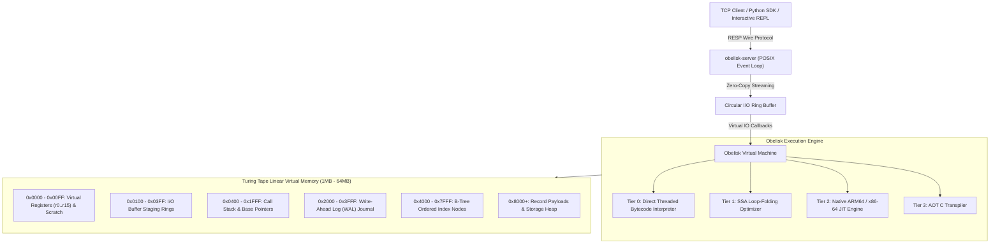

# Obelisk: System Architecture and Internal Subsystems

## 1. System Overview

Obelisk is a high-performance transactional database engine, optimizing multi-tier JIT compiler, and typed systems kernel constructed on top of a 1-D Turing tape execution substrate. Over 35,000 lines of runnable, verified Brainfuck code define the transactional storage engine, wire protocol tokenizer, B-tree index manager, write-ahead logging (WAL) journal, and cryptographic hashing algorithms.

The database runtime environment is engineered in C11 and C++20, providing zero-cost virtual memory translation, an intermediate representation (IR) compiler, SSA optimization passes, native machine code generation (JIT) for Apple Silicon (ARM64) and x86-64, and a multi-client TCP server daemon.

---

## 2. Multi-Tier Execution Pipeline

The execution architecture adopts a multi-tier compilation hierarchy tailored to the characteristics of 1-D tape computation:

### 2.1 Tier 0: Direct Threaded Bytecode Interpreter
Brainfuck text is tokenized and linearized into an array of `IrInstruction` records. When compiled with Clang or GCC, the execution loop uses computed gotos (`goto *dispatch_table[opcode]`) rather than a traditional switch loop. This eliminates branch misprediction penalties on modern superscalar branch target buffers (BTB).

### 2.2 Tier 1: SSA Loop-Folding Optimizer
The SSA optimization pass runs prior to execution and collapses common Brainfuck algorithmic idioms into synthetic hardware-accelerated instructions:
* **Arithmetic Coalescing**: Contiguous sequences of `+` and `-` collapse into a single `IR_ADD val` operation.
* **Pointer Shift Coalescing**: Contiguous sequences of `>` and `<` collapse into a single `IR_MOVE offset` operation.
* **Clear Loops**: Loops of the form `[-]` or `[+]` collapse into `IR_SET 0`.
* **Multiply-Add Loops**: Loops of the form `[->+++<]` collapse into `IR_ADD_MULT offset: +1, factor: 3`.
* **Zero Scans**: Loops of the form `[>]` and `[<]` collapse into `IR_SCAN_FWD` and `IR_SCAN_BCK`, accelerated via libc `memchr` vector instructions.

### 2.3 Tier 2: Native JIT Compiler
The JIT engine allocates dynamic executable pages via `mmap` with `PROT_READ | PROT_WRITE`, synthesizes native machine instructions, flushes CPU data caches, transitions page permissions to `PROT_READ | PROT_EXEC` via `mprotect`, and invalidates instruction caches (`sys_icache_invalidate` on Apple Silicon).

On Apple Silicon (ARM64):
* Callee-saved register `x19` is assigned exclusively to the tape head pointer (`uint8_t *`).
* Callee-saved register `x20` holds the execution context pointer.
* Cell mutations translate to single `ldrb` and `strb` instructions with immediate offsets.
* Conditional jumps translate to `cbz` and `cbnz` with backpatched branch offsets.

---

## 3. Storage Subsystem & Transactional Guarantees

### 3.1 Write-Ahead Logging (WAL)
Every mutation operation (`SET`, `DEL`) executed inside a transaction block (`BEGIN` ... `COMMIT`) records an undo intent entry in the WAL journal before modifying active storage. If `ROLLBACK` is issued, or if a client disconnects unexpectedly, the storage engine replays the undo log in reverse order, restoring previous values or purging newly inserted keys.

### 3.2 B-Tree Indexing on Tape
Keys are indexed in tape segments using fixed-stride node partitions. Binary search traverses node midpoints by evaluating pointer offsets, enabling logarithmic search over ordered records directly on the tape.
