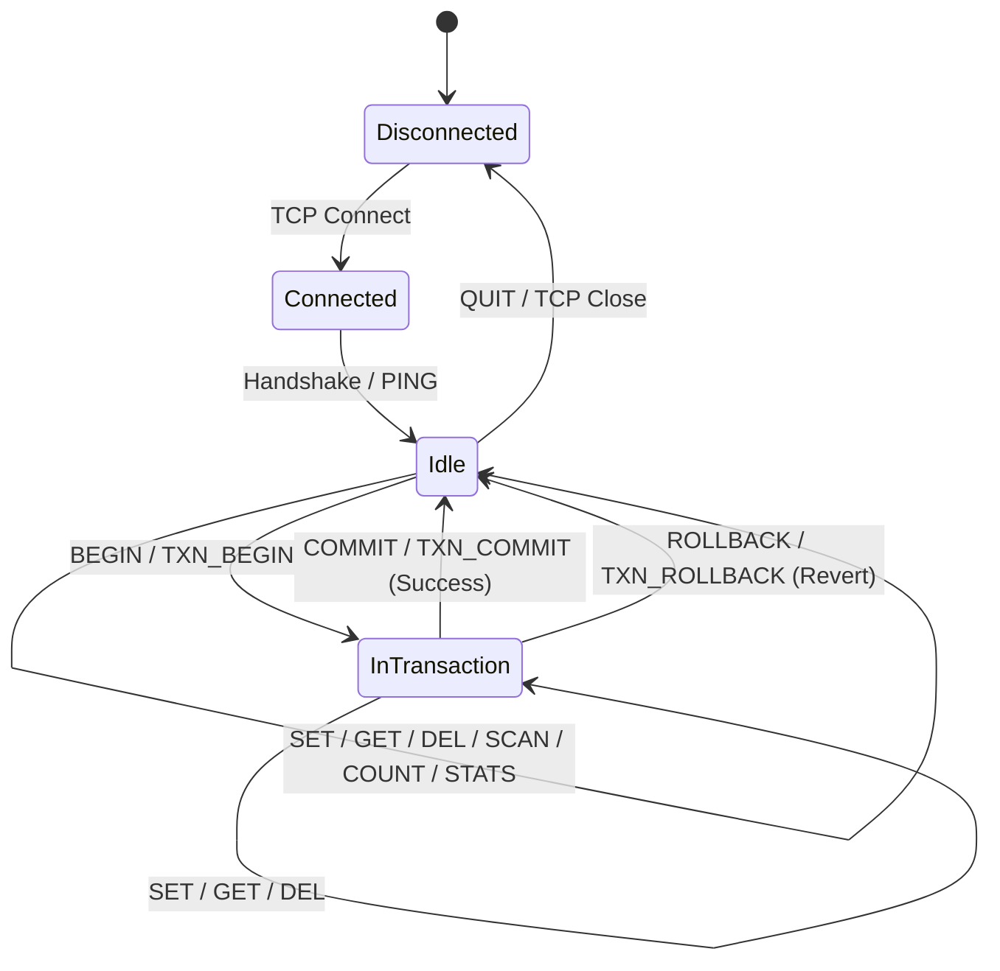

# Obelisk Wire Protocol Specification (OWP)

## 1. Protocol Architecture

The Obelisk Wire Protocol is a text-based, pipelined protocol compatible with the Redis Serialization Protocol (RESP v2). Clients interact with the database engine over TCP streams using carriage-return line-feed (`\r\n`) terminated frames.

---

## 2. Frame Type Encodings

| Frame Type | Prefix | Structure | Description |
| :--- | :--- | :--- | :--- |
| **Simple String** | `+` | `+<string>\r\n` | Success status, e.g. `+OK\r\n` |
| **Error Frame** | `-` | `-ERR <message>\r\n` | Error explanation |
| **Integer** | `:` | `:<int>\r\n` | Signed 64-bit integer, e.g. `:1\r\n` |
| **Bulk String** | `$` | `$<len>\r\n<data>\r\n` | Binary-safe payload |
| **Null Bulk** | `$` | `$-1\r\n` | Missing key / Nil response |
| **Array** | `*` | `*<count>\r\n...` | Array of child frames |

---

## 3. Command Reference

### `PING`
* **Syntax**: `PING`
* **Response**: `+PONG\r\n`

### `SET <key> <value>`
* **Syntax**: `SET key value`
* **Response**: `+OK\r\n` on success; `-ERR storage capacity full\r\n` on overflow.

### `GET <key>`
* **Syntax**: `GET key`
* **Response**: `$<len>\r\n<value>\r\n` or `$-1\r\n` if key does not exist.

### `DEL <key>`
* **Syntax**: `DEL key`
* **Response**: `:1\r\n` if deleted; `:0\r\n` if key was absent.

### `SCAN [prefix]`
* **Syntax**: `SCAN prefix`
* **Response**: Array frame containing matching key names.

### `COUNT`
* **Syntax**: `COUNT`
* **Response**: `:<count>\r\n` representing total active records.

### `TXN_BEGIN` / `BEGIN`
* **Syntax**: `BEGIN`
* **Response**: `+OK\r\n`. Initiates an atomic transaction block.

### `TXN_COMMIT` / `COMMIT`
* **Syntax**: `COMMIT`
* **Response**: `+OK\r\n`. Atomically commits all changes.

### `TXN_ROLLBACK` / `ROLLBACK`
* **Syntax**: `ROLLBACK`
* **Response**: `+OK\r\n`. Reverts all changes in the active transaction.
